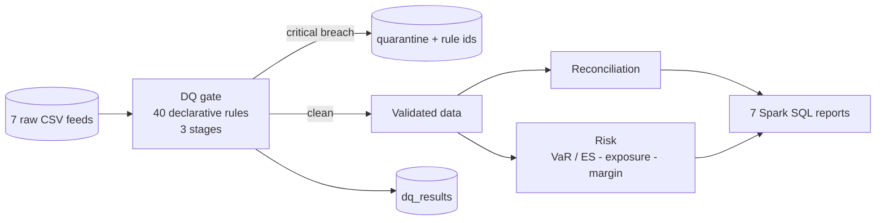

# Public Markets Data Platform

**PySpark + SQL data quality, reconciliation and risk analytics for public-markets data.**

A small but complete data product modelled on the domains a public-markets data team covers:
**market data, reference data, trade execution, and risk** (market risk, counterparty credit risk,
margining and collateral). It combines the *business analysis* side (requirements, user stories,
data dictionary, rule matrix, process flows) with the *hands-on data* side (PySpark pipeline, Spark SQL
reports, automated tests).

> **All data is synthetic.** Instruments, counterparties, identifiers, prices and trades are generated
> by `src/pmdp/generate_data.py`. Risk models are *illustrative implementations of standard mechanics*,
> not regulatory engines (no SA-CCR / IMM / FRTB).

## What it does

1. **Ingests** seven feeds (instruments, counterparties, prices, FX, trades, settlements, collateral) with explicit schemas.
2. **Validates** them with a declarative rule engine - 40 rules over completeness, validity, uniqueness, consistency, accuracy, timeliness and integrity. Critical breaches go to a **quarantine** with the ids of every rule they broke; warnings are reported but kept.
3. **Reconciles** front-office trades to back-office settlements and classifies every record into a break category.
4. **Computes risk** on validated data only: positions, 1-day 99% historical-simulation **VaR / Expected Shortfall**, counterparty **exposure with netting** (replacement cost, PFE add-on, EAD estimate) and CSA **margin calls / returns** (threshold, MTA, rounding).
5. **Publishes** seven analyst-facing **Spark SQL** reports on top of the results.

## Results on the sample data (`as_of` 2026-11-16, seed 42)

**Data-quality gate** - 40 rules: 20 PASS, 14 FAIL (critical), 6 WARN.

| Dataset | Rows in | Clean | Quarantined |
|---|---:|---:|---:|
| instruments | 40 | 36 | 4 |
| counterparties | 12 | 12 | 0 |
| prices | 11,998 | 11,992 | 6 |
| fx_rates | 1,200 | 1,200 | 0 |
| trades | 703 | 615 | 88 |
| settlements | 667 | 667 | 0 |
| collateral | 9 | 9 | 0 |

> **Cascade effect:** 4 bad instrument records (10% of the master) cause **67 trades** (9.5% of the blotter) to be rejected - 76% of the trade quarantine has that single root cause. Fixing four reference-data rows recovers more trades than fixing every trade-level fault combined.

**Reconciliation** (front office vs back office)

| Category | Records |
|---|---:|
| MATCHED | 577 |
| FO_REJECTED_BY_DQ (data problem, not a settlement problem) | 80 |
| QUANTITY_BREAK / AMOUNT_BREAK / MISSING_IN_BACK_OFFICE | 3 / 3 / 3 |
| SETTLE_DATE_BREAK / MISSING_IN_FRONT_OFFICE | 2 / 2 |

**Market risk** - 1-day 99%, 250 scenarios, USD

| Scope | VaR | Expected shortfall |
|---|---:|---:|
| **Portfolio** | **323,356** | **359,320** |
| Equity | 289,532 | 321,894 |
| Bond | 142,110 | 158,256 |
| ETF | 125,365 | 156,521 |

Portfolio VaR is 42% below the sum of the stand-alone figures (557,007) - the diversification benefit.

**Counterparty exposure and margin** - the six largest counterparties hold 78% of estimated EAD (largest: 29.9%). Margin run: 1 call (USD 220,000), 4 returns, 4 no action (nothing to exchange, or below the MTA), 3 counterparties without a CSA.

Full outputs are in [`docs/sample_output/`](docs/sample_output/).

## Architecture



More detail, including decision flows for reconciliation and margin: [`docs/05_process_flow.md`](docs/05_process_flow.md).

## Quickstart

Requirements: Python 3.10+ and **Java 17 or newer** (Spark needs a JVM).

```bash
git clone <this repo> && cd public-markets-data-platform
pip install -r requirements.txt && pip install -e .

python -m pmdp.pipeline          # generates the synthetic feeds if missing, runs everything (~30 s)
python -m pytest -q              # 21 tests incl. an end-to-end regression
python scripts/gen_rule_matrix.py   # regenerate docs/04_dq_rules_matrix.md from the rule definitions
```

Outputs land in `output/` (CSV): `dq_results`, `quarantine/`, `recon_trades`, `positions`, `var_summary`,
`counterparty_exposure`, `margin_calls`, and `sql/01..07_*.csv`.

## Repository layout

```
src/pmdp/
  config.py            thresholds and reference constants in one place
  generate_data.py     deterministic synthetic feeds with a documented fault-injection plan
  ingest.py            explicit schemas, file-order sequence
  data_quality.py      rule engine: single-pass evaluation, quarantine routing, results
  dq_rules.py          the 40 business rules per dataset
  spark_validators.py  ISIN check digit as a native Spark expression (no Python UDF)
  reconciliation.py    front-office vs back-office classification
  risk.py              positions, historical VaR/ES, exposure + netting, CSA margin
  pipeline.py          orchestration (ingest -> gate -> reconcile -> risk -> SQL)
sql/                   7 analyst reports (window functions, ranking, cumulative share, rolling vol)
tests/                 unit tests with hand-calculated expectations + end-to-end regression
docs/                  BRD, user stories, data dictionary, rule matrix, process flows, sample output
```

## Business-analysis artefacts

| Document | What it contains |
|---|---|
| [`01_business_requirements.md`](docs/01_business_requirements.md) | Problem statement, objectives and success measures, stakeholders, scope / out-of-scope, glossary, 16 functional + 6 non-functional requirements (MoSCoW), traceability, assumptions, open questions |
| [`02_user_stories.md`](docs/02_user_stories.md) | 11 user stories with Given/When/Then acceptance criteria, each traced to a requirement and a test |
| [`03_data_dictionary.md`](docs/03_data_dictionary.md) | Every field of every feed, output catalogue, and the fault-injection plan |
| [`04_dq_rules_matrix.md`](docs/04_dq_rules_matrix.md) | All 40 rules with dimension, severity and business rationale - generated from code |
| [`05_process_flow.md`](docs/05_process_flow.md) | Mermaid diagrams: end-to-end flow, rule outcomes, reconciliation and margin decision logic |

## Design decisions worth noting

- **Rules are data, not code paths.** A `Rule` is an id, a dimension, a severity and a failure predicate. Adding a control is one entry plus one test, and it appears in the documentation automatically.
- **Quarantine, never delete.** Rejected rows keep every rule that caught them, so a data owner gets an actionable defect instead of a vanished record.
- **Validate in stages, against validated data.** Reference data first, then market data, then transactions; this is what makes the cascade effect visible and measurable rather than silent.
- **A NULL predicate never fails a row.** "Cannot be evaluated" (e.g. no close price for the trade date) is different from "wrong".
- **Reconciliation separates data problems from settlement problems.** Back-office records whose front-office trade was rejected by the gate are labelled `FO_REJECTED_BY_DQ` instead of inflating the break list.
- **Native Spark expressions over Python UDFs.** The ISO 6166 check digit uses higher-order SQL functions; a test proves it agrees with the Python reference on 900+ valid, mutated and malformed identifiers. (A first version used a UDF and failed in the test run because Spark workers could not import the package - the rewrite removed that class of failure.)
- **Tests assert business numbers, not just "it runs".** VaR 49,000 / ES 49,500 on a hand-built scenario set, RC 7,500 / PFE 28,050 / EAD 35,550 on a hand-built netting set, and an end-to-end test that every injected fault is caught by exactly the expected rule.

## Limitations (deliberate and documented)

- Illustrative add-on factors and a CEM-style netting adjustment; **not** SA-CCR and not for regulatory use.
- Cash products only (equities, bonds, ETFs); no derivatives pricing, initial margin, haircuts or multi-currency collateral.
- Weekday-only calendar, `double` amounts, one netting set per counterparty.
- A stale collateral balance is a WARNING, so it still feeds the margin calculation. In the sample, the one margin call (CP04) is computed on a balance that COL_003 flags as 5 days old - a good example of an open business question (see BRD Q1).
- Verified on Spark 4.3; `pyspark>=3.5` is declared but Spark 3.5 has not been run.

## Roadmap

- Make stale collateral blocking and add a repair queue for rejected trades (BRD Q1, Q3).
- Asset-class-specific price tolerances and a per-market holiday calendar (Q4, Q5).
- Persist results to Parquet/Delta and add run-over-run DQ trend reporting.
- Parameterise the pipeline for a cluster (S3/ADLS paths) and add a Great Expectations / dbt-style export of the rule catalogue.
