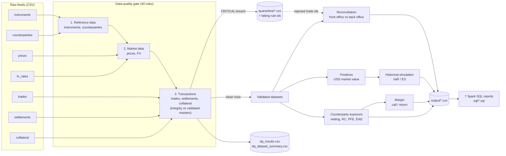
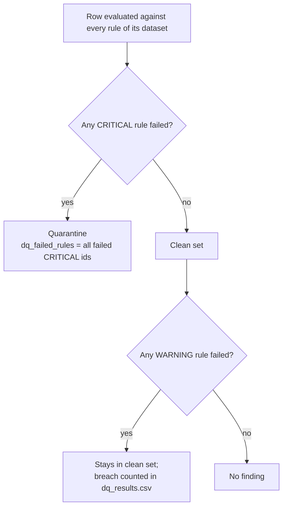
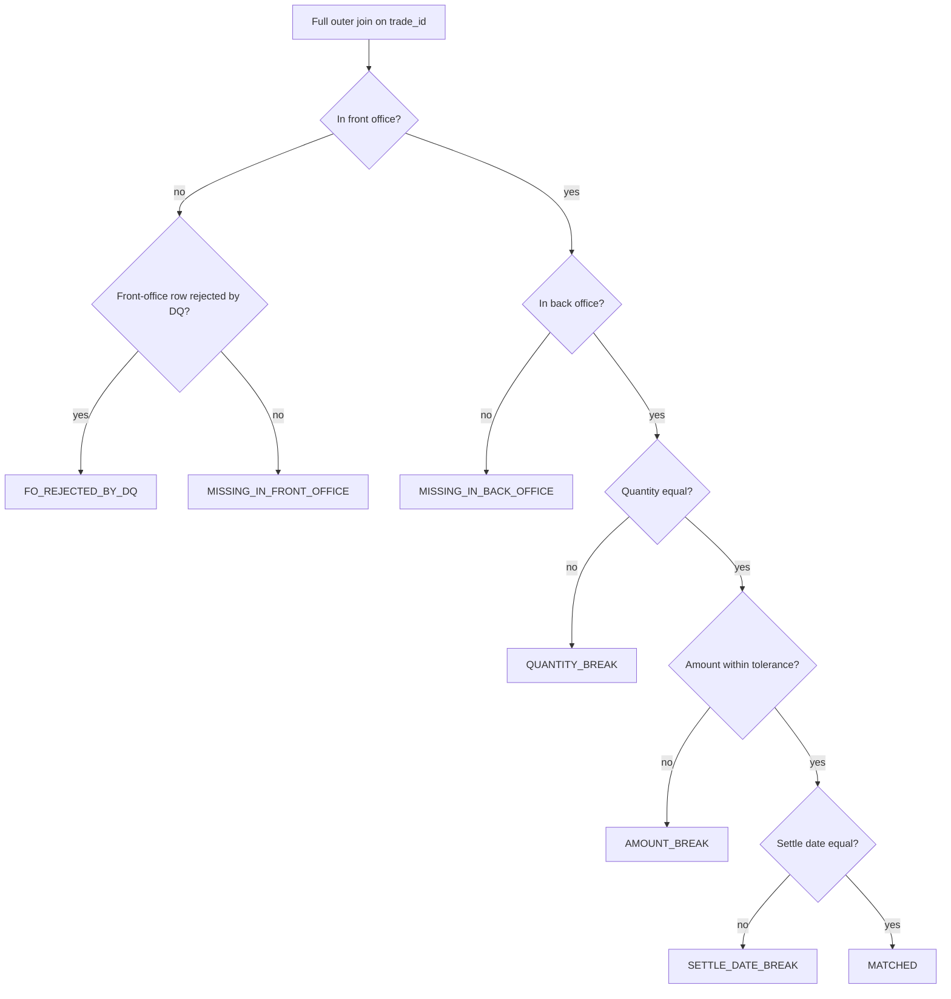
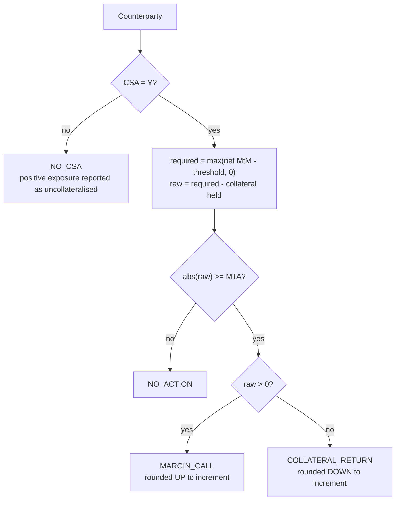

# 05 - Process flow and data lineage

## End-to-end flow

## Why the gate runs in three stages

Each stage validates against the **already validated** output of the previous one:

1. **Reference data first.** A bad instrument must be rejected before anything can reference it.
2. **Market data second.** Prices are checked against the raw instrument ids (existence only) so one root cause is not counted twice.
3. **Transactions last.** Trades and collateral are checked for referential integrity against the *validated* instrument and counterparty masters, and for price sanity against the validated prices.

The consequence is intentional and visible in the results: a defect in a master record cascades to every
transaction that points at it (4 bad instruments -> 67 rejected trades on the sample), and the
reconciliation labels the matching back-office records `FO_REJECTED_BY_DQ` so operations do not chase them
as settlement breaks.

## Rule outcome logic

A rule predicate that evaluates to NULL (cannot be evaluated, e.g. no close price for the trade date)
never fails a row.

## Reconciliation decision order

## Margin decision logic

## Run order and outputs

| Step | Module | Output |
|---|---|---|
| Generate (optional) | `generate_data.py` | `data/raw/*.csv` |
| Ingest | `ingest.py` | staging DataFrames with `ingest_seq` |
| DQ gate | `dq_rules.py`, `data_quality.py` | `dq_results.csv`, `dq_dataset_summary.csv`, `quarantine/` |
| Reconcile | `reconciliation.py` | `recon_trades.csv`, `recon_summary.csv` |
| Risk | `risk.py` | `positions.csv`, `var_summary.csv`, `counterparty_exposure.csv`, `margin_calls.csv` |
| SQL reports | `sql_reports.py` + `sql/*.sql` | `sql/*.csv` |
